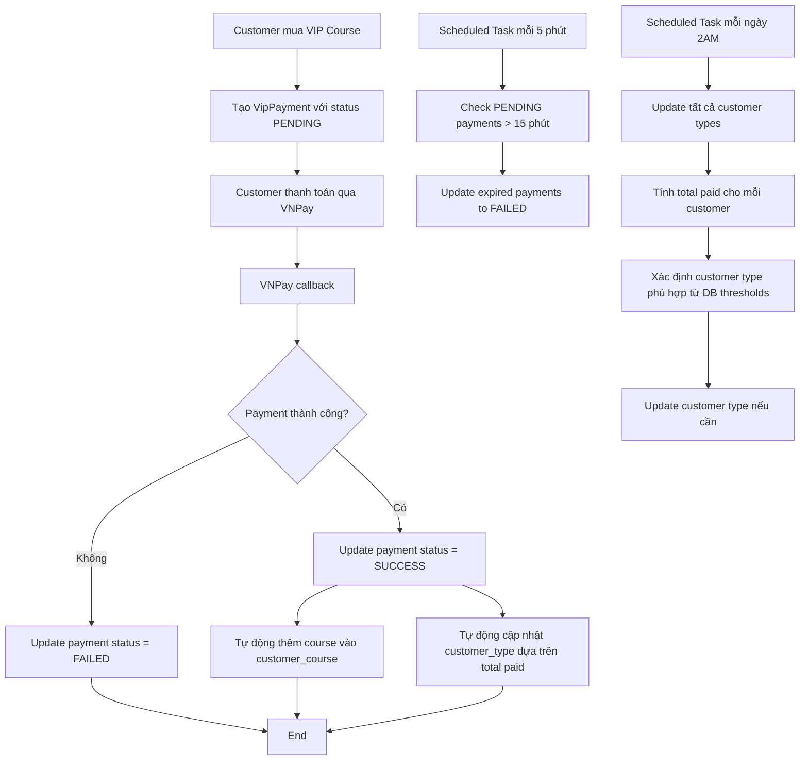

# Hệ Thống Quản Lý Thanh Toán và Customer Type

## Tổng Quan

Hệ thống này tự động quản lý trạng thái thanh toán VIP và cập nhật customer type dựa trên tổng số tiền đã thanh toán. **Các ngưỡng (threshold) để xác định customer type được lấy từ trường `price` trong bảng `customer_type` thay vì hardcode trong code.**

## Tính Năng Chính

### 1. Tự Động Cập Nhật Trạng Thái Payment

**Quy tắc**: Các payment có trạng thái PENDING quá 15 phút sẽ tự động chuyển thành FAILED.

**Cách hoạt động**:
- Scheduled task chạy mỗi 5 phút
- Kiểm tra tất cả payment PENDING
- Cập nhật thành FAILED nếu `created_date` > 15 phút
- Ghi log chi tiết

**Endpoint quản lý**:
```
POST /api/v1/payment/admin/update-expired-payments
GET /api/v1/payment/admin/expired-pending-payments
```

### 2. Tự Động Cập Nhật Customer Type

**Logic phân loại động**:
- Hệ thống đọc các ngưỡng từ bảng `customer_type` theo thứ tự `price` tăng dần
- So sánh tổng số tiền customer đã thanh toán với các ngưỡng này
- Chọn customer type cao nhất mà customer đã đạt được

**Ví dụ với dữ liệu trong database**:
- `customer_type_id = 1` (Regular): `price = 0`
- `customer_type_id = 2` (Premium): `price = 1000000` 
- `customer_type_id = 3` (VIP): `price = 5000000`

**Logic**:
- `< 1,000,000 VND`: Regular 
- `>= 1,000,000 VND và < 5,000,000 VND`: Premium
- `>= 5,000,000 VND`: VIP

**Cách hoạt động**:
- Tính tổng tiền từ tất cả payment SUCCESS
- Tự động cập nhật khi có payment thành công
- Scheduled task chạy hàng ngày lúc 2:00 AM
- Cập nhật cho tất cả customers

**Endpoint quản lý**:
```
POST /api/v1/payment/admin/update-customer-type/{customerId}
POST /api/v1/payment/admin/update-all-customer-types
GET /api/v1/payment/admin/customer-payment-stats/{customerId}
GET /api/v1/admin/customer-type-thresholds
GET /api/v1/admin/test-customer-type/{amount}
```

### 3. Admin Dashboard

**Endpoint chính**:
```
GET /api/v1/admin/payment-management
GET /api/v1/admin/customer-type-stats
GET /api/v1/admin/system-health
GET /api/v1/admin/customer-type-thresholds
```

**Thông tin cung cấp**:
- Tổng quan payments (SUCCESS/FAILED/PENDING)
- Danh sách payments quá hạn
- Thống kê customer types
- **Thông tin thresholds từ database**
- Gợi ý customer type dựa trên số tiền đã thanh toán (sử dụng database thresholds)
- Health check của hệ thống

## API Endpoints

### Payment Management

#### 1. Lấy thống kê tổng quan
```http
GET /api/v1/admin/payment-management
Authorization: Bearer {admin_token}
```

**Response**:
```json
{
  "overview": {
    "totalPayments": 25,
    "successPayments": 20,
    "failedPayments": 3,
    "pendingPayments": 2,
    "expiredPayments": 1,
    "successRate": 80.0
  },
  "urgentPayments": [
    {
      "paymentId": 1,
      "vnpTxnRef": "VIP_1716888234567",
      "customerName": "Nguyễn Văn A",
      "courseName": "Advanced Total Body",
      "amount": 1990000,
      "createdDate": "2025-05-28T13:57:22",
      "minutesExpired": 295
    }
  ],
  "timestamp": "2025-05-28T18:51:00"
}
```

#### 2. Cập nhật payment status thủ công
```http
POST /api/v1/admin/update-payment-status/{paymentId}?newStatus=FAILED
Authorization: Bearer {admin_token}
```

#### 3. Lấy danh sách payments quá hạn
```http
GET /api/v1/payment/admin/expired-pending-payments
Authorization: Bearer {admin_token}
```

### Customer Type Management

#### 1. Lấy thống kê customer types
```http
GET /api/v1/admin/customer-type-stats
Authorization: Bearer {admin_token}
```

**Response**:
```json
{
  "typeStats": {
    "Regular": 15,
    "Premium": 8,
    "VIP": 3
  },
  "customerDetails": [
    {
      "customerId": 3,
      "customerName": "Nguyễn Văn Ba",
      "currentType": "Regular",
      "currentTypeId": 1,
      "totalPaid": 3980000,
      "suggestedType": "Premium",
      "suggestedTypeId": 2,
      "needsUpdate": true
    }
  ],
  "totalCustomers": 26,
  "thresholds": [
    {
      "customerTypeId": 1,
      "customerTypeName": "Regular",
      "threshold": 0
    },
    {
      "customerTypeId": 2,
      "customerTypeName": "Premium", 
      "threshold": 1000000
    },
    {
      "customerTypeId": 3,
      "customerTypeName": "VIP",
      "threshold": 5000000
    }
  ],
  "timestamp": "2025-05-28T18:51:00"
}
```

#### 2. Lấy thông tin customer type thresholds
```http
GET /api/v1/admin/customer-type-thresholds
Authorization: Bearer {admin_token}
```

**Response**:
```json
{
  "thresholds": [
    {
      "customerTypeId": 1,
      "customerTypeName": "Regular",
      "threshold": 0
    },
    {
      "customerTypeId": 2,
      "customerTypeName": "Premium",
      "threshold": 1000000
    },
    {
      "customerTypeId": 3,
      "customerTypeName": "VIP",
      "threshold": 5000000
    }
  ],
  "message": "Customer type thresholds retrieved from database",
  "timestamp": "2025-05-28T18:51:00"
}
```

#### 3. Test xác định customer type theo số tiền
```http
GET /api/v1/admin/test-customer-type/2500000
Authorization: Bearer {admin_token}
```

**Response**:
```json
{
  "amount": 2500000,
  "allThresholds": [
    {
      "customerTypeId": 1,
      "customerTypeName": "Regular",
      "threshold": 0
    },
    {
      "customerTypeId": 2,
      "customerTypeName": "Premium",
      "threshold": 1000000
    },
    {
      "customerTypeId": 3,
      "customerTypeName": "VIP",
      "threshold": 5000000
    }
  ],
  "suggestedType": "Premium",
  "suggestedTypeId": 2,
  "threshold": 1000000,
  "message": "Customer type determination test completed",
  "timestamp": "2025-05-28T18:51:00"
}
```

#### 4. Cập nhật customer type cho một customer
```http
POST /api/v1/payment/admin/update-customer-type/{customerId}
Authorization: Bearer {admin_token}
```

#### 5. Cập nhật customer type cho tất cả customers
```http
POST /api/v1/payment/admin/update-all-customer-types
Authorization: Bearer {admin_token}
```

## Customer Type CRUD Management

### 1. Lấy tất cả Customer Types
```http
GET /api/v1/admin/customer-types
Authorization: Bearer {admin_token}
```

**Response**:
```json
{
  "customerTypes": [
    {
      "customerTypeId": 1,
      "customerTypeName": "Regular",
      "price": 0,
      "customerCount": 15
    },
    {
      "customerTypeId": 2,
      "customerTypeName": "Premium",
      "price": 150000,
      "customerCount": 8
    },
    {
      "customerTypeId": 3,
      "customerTypeName": "VIP",
      "price": 399000,
      "customerCount": 3
    }
  ],
  "totalTypes": 3,
  "timestamp": "2025-05-28T20:30:00"
}
```

### 2. Lấy Customer Type theo ID
```http
GET /api/v1/admin/customer-types/{id}
Authorization: Bearer {admin_token}
```

### 3. Tạo Customer Type mới
```http
POST /api/v1/admin/customer-types
Authorization: Bearer {admin_token}
Content-Type: application/json

{
  "customerTypeName": "Platinum",
  "price": 1000000
}
```

**Response**:
```json
{
  "customerType": {
    "customerTypeId": 4,
    "customerTypeName": "Platinum",
    "price": 1000000
  },
  "message": "Customer type created successfully",
  "timestamp": "2025-05-28T20:30:00"
}
```

### 4. Cập nhật Customer Type
```http
PUT /api/v1/admin/customer-types/{id}
Authorization: Bearer {admin_token}
Content-Type: application/json

{
  "customerTypeName": "Premium Plus",
  "price": 200000
}
```

### 5. Xóa Customer Type
```http
DELETE /api/v1/admin/customer-types/{id}
Authorization: Bearer {admin_token}
```

**Lưu ý**: Chỉ có thể xóa nếu không có customer nào đang sử dụng type này.

**Response nếu có customers đang dùng**:
```json
{
  "error": "Cannot delete customer type",
  "message": "There are 5 customers using this type",
  "customersCount": 5
}
```

### 6. Áp dụng Thresholds mới cho tất cả Customers
```http
POST /api/v1/admin/customer-types/apply-thresholds
Authorization: Bearer {admin_token}
```

Endpoint này sẽ trigger việc cập nhật customer type cho tất cả customers dựa trên thresholds mới.

### System Health

#### 1. Kiểm tra trạng thái hệ thống
```http
GET /api/v1/admin/system-health
Authorization: Bearer {admin_token}
```

## Scheduled Tasks

### 1. Cập nhật Payments Quá Hạn
- **Thời gian**: Mỗi 5 phút
- **Cron**: `fixedRate = 300000` (5 phút = 300,000ms)
- **Class**: `PaymentStatusService.updateExpiredPendingPayments()`

### 2. Cập nhật Customer Types
- **Thời gian**: Hàng ngày lúc 2:00 AM
- **Cron**: `0 0 2 * * *`
- **Class**: `PaymentStatusService.updateAllCustomerTypes()`

## Database Queries

### 1. Tìm Payments Quá Hạn
```sql
SELECT p FROM VipPayment p 
WHERE p.paymentStatus = 'PENDING' 
AND p.createdDate < :expiryTime 
ORDER BY p.createdDate ASC
```

### 2. Tính Tổng Tiền Đã Thanh Toán
```sql
SELECT COALESCE(SUM(p.amount), 0) 
FROM VipPayment p 
WHERE p.customer.customerId = :customerId 
AND p.paymentStatus = 'SUCCESS'
```

### 3. Lấy Customer Types theo thứ tự Price (MỚI)
```sql
SELECT ct FROM CustomerType ct 
ORDER BY ct.price ASC
```

### 4. Tìm Customer Type theo tên (MỚI)
```sql
SELECT ct FROM CustomerType ct 
WHERE ct.customerTypeName = :typeName
```

## Cấu Trúc Database

### Bảng customer_type
```sql
CREATE TABLE customer_type (
    customer_type_id INT PRIMARY KEY AUTO_INCREMENT,
    customer_type_name VARCHAR(50) NOT NULL,
    price DOUBLE -- Ngưỡng tiền để đạt được customer type này
);
```

**Dữ liệu mẫu**:
```sql
INSERT INTO customer_type (customer_type_id, customer_type_name, price) VALUES
(1, 'Regular', 0),
(2, 'Premium', 1000000),
(3, 'VIP', 5000000);
```

**Ý nghĩa**:
- `price = 0`: Customer chưa thanh toán gì → Regular
- `price = 1000000`: Customer đã thanh toán từ 1,000,000 VND trở lên → Premium  
- `price = 5000000`: Customer đã thanh toán từ 5,000,000 VND trở lên → VIP

### Logic Xác Định Customer Type

```java
// Pseudocode
List<CustomerType> types = customerTypeRepository.findAllOrderByPriceAsc();
CustomerType appropriateType = null;

for (CustomerType type : types) {
    if (totalPaid >= type.getPrice()) {
        appropriateType = type; // Cập nhật type cao nhất đạt được
    } else {
        break; // Dừng khi gặp threshold chưa đạt được
    }
}

// Nếu không đạt threshold nào, chọn type có price thấp nhất (Regular)
if (appropriateType == null) {
    appropriateType = types.get(0);
}
```

## Logging

**Level**: INFO, DEBUG
**Locations**: 
- `logs/application.log`
- Console output

**Key log messages**:
- Payment status updates
- Customer type changes
- Scheduled task executions
- Error handling

## Ví Dụ Sử Dụng

### Kiểm tra Payment ID 1 (đã quá hạn)

1. **Kiểm tra trạng thái hiện tại**:
```bash
curl -X GET "http://localhost:8080/api/v1/admin/payment-management" \
  -H "Authorization: Bearer {admin_token}"
```

2. **Cập nhật thủ công thành FAILED**:
```bash
curl -X POST "http://localhost:8080/api/v1/admin/update-payment-status/1?newStatus=FAILED" \
  -H "Authorization: Bearer {admin_token}"
```

3. **Kiểm tra lại**:
```bash
curl -X GET "http://localhost:8080/api/v1/payment/status/VIP_1716888234567" \
  -H "Authorization: Bearer {user_token}"
```

### Kiểm tra Customer Type Thresholds

1. **Xem thresholds hiện tại từ database**:
```bash
curl -X GET "http://localhost:8080/api/v1/admin/customer-type-thresholds" \
  -H "Authorization: Bearer {admin_token}"
```

2. **Test xác định customer type với số tiền cụ thể**:
```bash
curl -X GET "http://localhost:8080/api/v1/admin/test-customer-type/2500000" \
  -H "Authorization: Bearer {admin_token}"
```

**Response sẽ cho biết**:
- Customer với 2,500,000 VND sẽ được xếp vào loại "Premium"
- Vì 2,500,000 >= 1,000,000 (threshold Premium) nhưng < 5,000,000 (threshold VIP)

3. **Test toàn bộ logic customer type với nhiều số tiền**:
```bash
curl -X GET "http://localhost:8080/api/v1/payment/test-customer-type-logic"
```

**Response sẽ bao gồm**:
```json
{
  "testResults": [
    {
      "amount": 0,
      "suggestedType": "Regular",
      "suggestedTypeId": 1,
      "threshold": 0
    },
    {
      "amount": 500000,
      "suggestedType": "Regular", 
      "suggestedTypeId": 1,
      "threshold": 0
    },
    {
      "amount": 1000000,
      "suggestedType": "Premium",
      "suggestedTypeId": 2,
      "threshold": 1000000
    },
    {
      "amount": 2500000,
      "suggestedType": "Premium",
      "suggestedTypeId": 2,
      "threshold": 1000000
    },
    {
      "amount": 5000000,
      "suggestedType": "VIP",
      "suggestedTypeId": 3,
      "threshold": 5000000
    },
    {
      "amount": 10000000,
      "suggestedType": "VIP",
      "suggestedTypeId": 3,
      "threshold": 5000000
    }
  ],
  "databaseThresholds": [
    {
      "customerTypeId": 1,
      "customerTypeName": "Regular",
      "threshold": 0
    },
    {
      "customerTypeId": 2,
      "customerTypeName": "Premium",
      "threshold": 1000000
    },
    {
      "customerTypeId": 3,
      "customerTypeName": "VIP",
      "threshold": 5000000
    }
  ],
  "message": "Customer type logic test completed using database thresholds"
}
```

### Cập nhật Customer Type

1. **Xem thống kê hiện tại**:
```bash
curl -X GET "http://localhost:8080/api/v1/payment/admin/customer-payment-stats/3" \
  -H "Authorization: Bearer {admin_token}"
```

2. **Cập nhật customer type (sử dụng database thresholds)**:
```bash
curl -X POST "http://localhost:8080/api/v1/payment/admin/update-customer-type/3" \
  -H "Authorization: Bearer {admin_token}"
```

### Quản Lý Customer Type CRUD

1. **Xem tất cả customer types hiện tại**:
```bash
curl -X GET "http://localhost:8080/api/v1/admin/customer-types" \
  -H "Authorization: Bearer {admin_token}"
```

2. **Tạo customer type mới (Platinum với threshold 10,000,000 VND)**:
```bash
curl -X POST "http://localhost:8080/api/v1/admin/customer-types" \
  -H "Authorization: Bearer {admin_token}" \
  -H "Content-Type: application/json" \
  -d '{
    "customerTypeName": "Platinum",
    "price": 10000000
  }'
```

3. **Cập nhật threshold của Premium từ 150,000 thành 200,000**:
```bash
curl -X PUT "http://localhost:8080/api/v1/admin/customer-types/2" \
  -H "Authorization: Bearer {admin_token}" \
  -H "Content-Type: application/json" \
  -d '{
    "customerTypeName": "Premium",
    "price": 200000
  }'
```

4. **Áp dụng thresholds mới cho tất cả customers**:
```bash
curl -X POST "http://localhost:8080/api/v1/admin/customer-types/apply-thresholds" \
  -H "Authorization: Bearer {admin_token}"
```

5. **Kiểm tra kết quả sau khi cập nhật**:
```bash
curl -X GET "http://localhost:8080/api/v1/admin/customer-type-stats" \
  -H "Authorization: Bearer {admin_token}"
```

6. **Test logic với threshold mới**:
```bash
curl -X GET "http://localhost:8080/api/v1/payment/test-customer-type-logic"
```

## Troubleshooting

### 1. Scheduled Tasks không chạy
- Kiểm tra `@EnableScheduling` trong main class
- Xem logs: `logging.level.org.springframework.scheduling=DEBUG`

### 2. Customer Type không tự động cập nhật
- **MỚI**: Kiểm tra dữ liệu trong bảng `customer_type`:
  ```sql
  SELECT * FROM customer_type ORDER BY price ASC;
  ```
- Đảm bảo trường `price` có giá trị hợp lệ
- Kiểm tra `PaymentStatusService` có được inject đúng không
- Xem logs để check logic tính toán

### 3. Threshold logic không đúng
- **MỚI**: Test endpoint để kiểm tra:
  ```bash
  curl -X GET "http://localhost:8080/api/v1/admin/test-customer-type/{amount}"
  ```
- Kiểm tra order của customer types trong database
- Đảm bảo `price` values trong database đúng với business logic

### 4. Database queries chậm
- Thêm index cho `created_date`, `payment_status`
- **MỚI**: Thêm index cho `customer_type.price`:
  ```sql
  CREATE INDEX idx_customer_type_price ON customer_type(price);
  ```
- Monitor query performance

### 5. Customer Type Thresholds sai
- **Cách kiểm tra**:
  ```bash
  # Xem thresholds hiện tại
  curl -X GET "http://localhost:8080/api/v1/admin/customer-type-thresholds"
  
  # Test với số tiền cụ thể
  curl -X GET "http://localhost:8080/api/v1/admin/test-customer-type/1500000"
  ```
- **Cách sửa**: Cập nhật trực tiếp trong database:
  ```sql
  UPDATE customer_type SET price = 2000000 WHERE customer_type_id = 2;
  ```

## Workflow Tổng Quan

### 🔄 **Flow của Payment System**



### 🎯 **Tính Toán Customer Type**

```sql
-- Flow tính toán customer type
1. Lấy tổng tiền đã thanh toán SUCCESS:
   SELECT COALESCE(SUM(amount), 0) FROM vip_payment 
   WHERE customer_id = ? AND payment_status = 'SUCCESS'

2. Lấy customer types theo thứ tự price:
   SELECT * FROM customer_type ORDER BY price ASC

3. Logic xác định type:
   FOR each type IN customer_types:
     IF total_paid >= type.price:
       appropriate_type = type
     ELSE:
       BREAK
   
4. Update customer:
   UPDATE customer SET customer_type_id = appropriate_type.id 
   WHERE customer_id = ?
```

### 📊 **Admin Dashboard Features**

1. **Payment Management**: Monitor payments, expired payments, manual updates
2. **Customer Type Stats**: View distribution, suggested updates, bulk operations  
3. **Customer Type CRUD**: Create, read, update, delete customer types
4. **Threshold Testing**: Test logic với các số tiền khác nhau
5. **System Health**: Monitor database, scheduled tasks, recent activities

### 🔧 **Best Practices**

1. **Performance**: 
   - Sử dụng indexes phù hợp
   - Monitor slow queries
   - Cache customer type thresholds nếu cần

2. **Data Integrity**:
   - Luôn validate input data
   - Handle edge cases (NULL values, negative amounts)
   - Log tất cả changes cho audit trail

3. **Security**:
   - Tất cả admin endpoints require ADMIN role
   - Validate và sanitize input
   - Rate limiting cho sensitive operations

4. **Maintenance**:
   - Regular backup database
   - Monitor logs for errors
   - Review customer type distribution quarterly

## Security

- Tất cả admin endpoints yêu cầu `@PreAuthorize("hasRole('ADMIN')")`
- User endpoints yêu cầu `@PreAuthorize("hasRole('USER')")`
- Logging không ghi thông tin nhạy cảm (password, payment details)

## Maintenance

### Thường xuyên
- Monitor logs trong `logs/application.log`
- Kiểm tra `/admin/system-health`

### Hàng tuần  
- Review payment statistics
- Check customer type distribution

### Hàng tháng
- Database cleanup cho old logs
- Performance analysis 